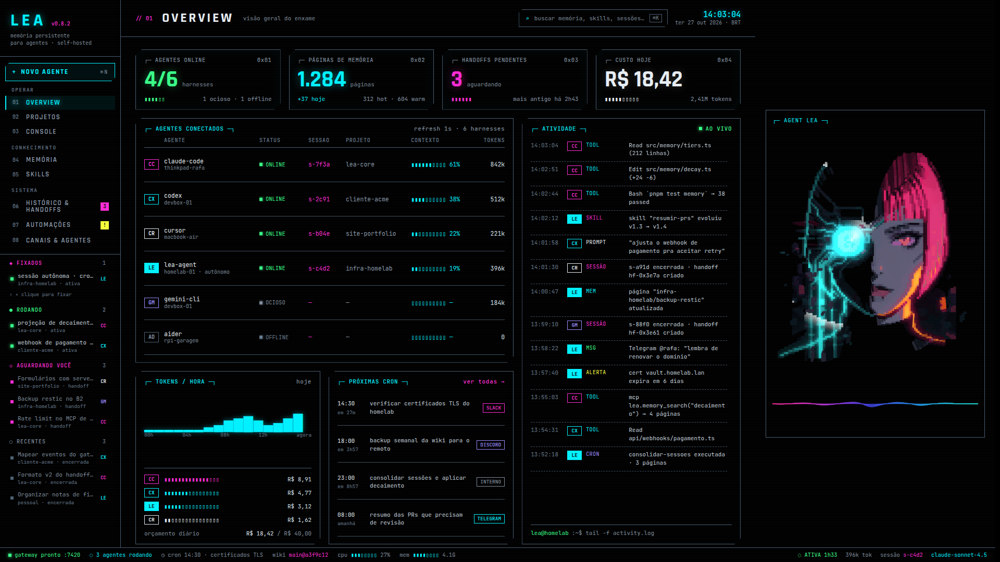
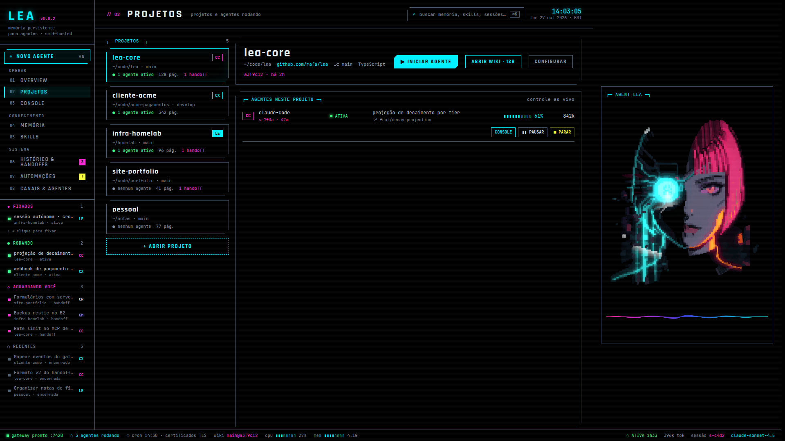
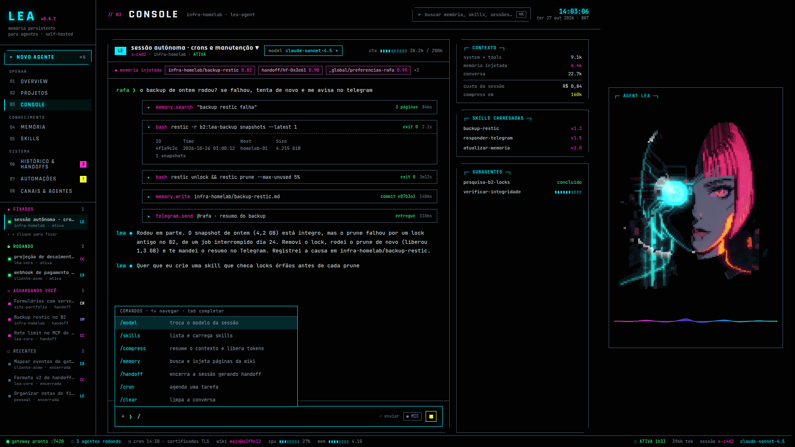
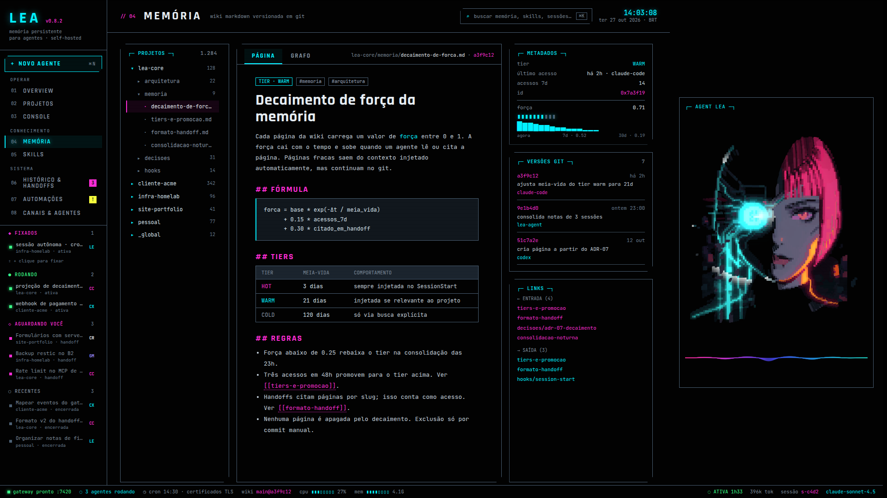
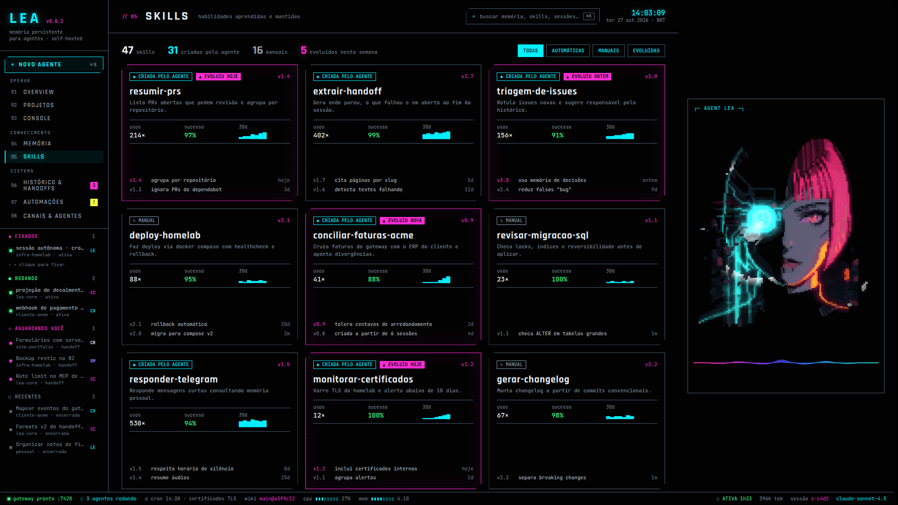
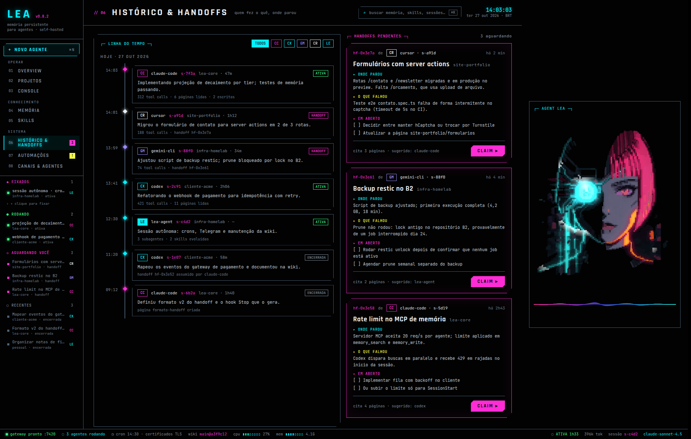
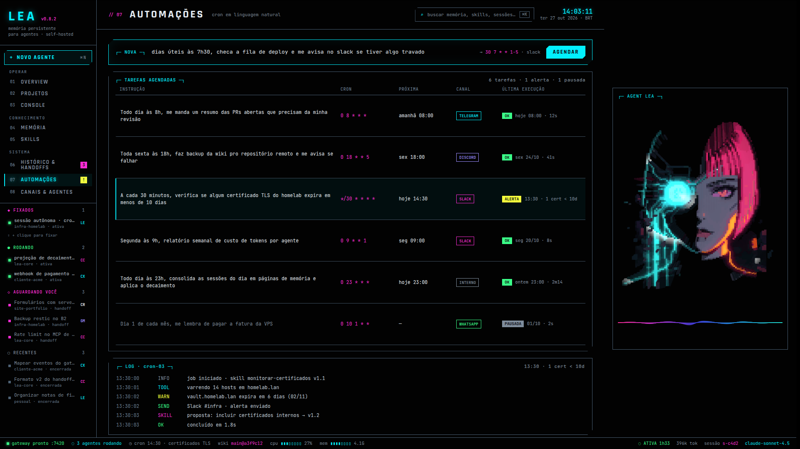
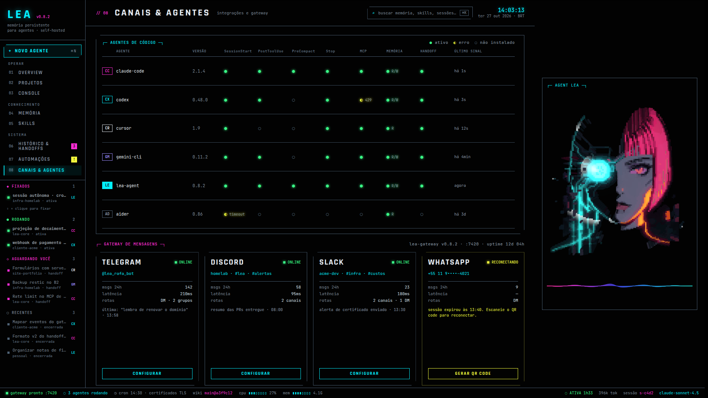
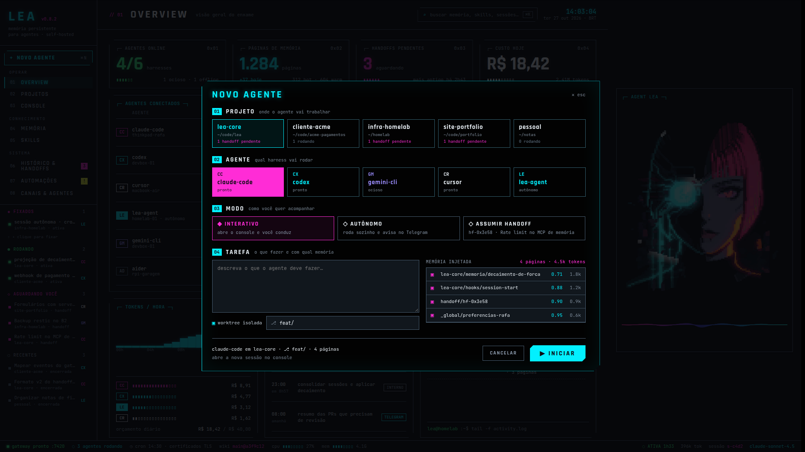

# LEA-Agent

Centro de comando **self-hosted** para agentes de IA com memória persistente.
É um **programa desktop em Python**, que roda na máquina do usuário — não é um
site nem um serviço hospedado.

O que ele une:

1. **Memória compartilhada entre agentes de código** (Claude Code, Codex CLI,
   Gemini CLI, Cursor, Aider) — uma wiki em Markdown versionada em git, com
   força/decaimento por página, busca, backlinks e handoffs entre agentes.
2. **Um agente autônomo próprio (lea-agent)** — aprende e melhora skills, roda
   tarefas agendadas escritas em linguagem natural e conversa por Telegram e
   Discord.

Diferente de um agente que quer substituir os outros, o LEA deixa cada agente
continuar sendo ele mesmo e fica **entre** eles, como camada de memória e
supervisão. Ver [docs/estudo-hermes.md](docs/estudo-hermes.md).



## Estado: Fases 1 a 4 concluídas; Fase 5 em andamento

O núcleo é um **daemon headless** com API local, WebSocket de eventos e receptor
de hooks. A interface é um cliente dele — é o que permite rodar sem janela num
homelab e trocar a camada visual sem mexer no produto.

| | |
|---|---|
| ✅ Fase 1 | núcleo: config, banco com migrações, barramento de eventos, CLI, tokens locais, scanner de injeção |
| ✅ Fase 2 | memória: wiki git, busca FTS, decaimento, grafo, injeção de contexto, servidor MCP |
| ✅ Fase 3 | projetos, launcher, adaptadores de harness, hooks, PTY, worktrees |
| ✅ Fase 4 | handoffs: geração no Stop, claim, injeção no contexto |
| 🟡 Fase 5 | lea-agent, skills e cron — aprovações nativas dos CLIs pendentes |
| ✅ Fase 6 | bots Telegram e Discord com allowlist e rotas por projeto |
| 🟡 Fase 7 | custo estimado da Anthropic API; empacotamento pendente |

A camada de interface ainda não foi escolhida — ver [Interface & Telas do Projeto](#interface--telas-do-projeto).

## Rodar

Requer Python 3.12+ e [uv](https://docs.astral.sh/uv/).

```bash
uv sync --extra dev
uv run lea doctor      # confere instalação, permissões e banco
uv run lea daemon      # sobe o núcleo em 127.0.0.1:7420
uv run pytest          # 206 testes (unidade + aceite)
```

Testes de aceite exercitam o LEA pela borda — HTTP, WebSocket, MCP por stdio,
processos reais sob PTY — e verificam o critério de cada fase:

```bash
uv run pytest tests/acceptance -q
```

`lea doctor` numa instalação limpa cria `~/.lea/` (config, banco, wiki, skills,
worktrees, logs), com os diretórios em `0700` e os tokens em `0600`.

### Comandos

```
lea daemon    sobe o núcleo, sem janela (serve para homelab)
lea hook      ponte chamada de dentro dos agentes de código
lea mcp        servidor MCP lea.memory, por stdio
lea harnesses  matriz de integração dos agentes; --install para configurar
lea reindex    reconstrói o índice da memória a partir do git
lea run        executa uma tarefa via Codex CLI, Claude Code ou Anthropic API
lea doctor     diagnostica a instalação
```

## Agentes de código

```
$ lea harnesses
agente          versão                 hooks  mcp  observação
CC Claude Code  2.1.278 (Claude Code)  ●      ●
CX Codex CLI    codex-cli 0.164.0      ◐      ●    1 hook aguardando confiança
```

`lea harnesses --install claude-code` registra os hooks de ciclo de vida
(`SessionStart`, `PostToolUse`, `PreCompact`, `Stop`) e o servidor MCP de
memória.

**Isso altera a configuração de outra ferramenta na sua máquina**, então é um
comando explícito e nunca roda sozinho. Antes de tocar em qualquer arquivo o
LEA faz backup, e a escrita é sempre **merge**: hooks de outras ferramentas que
já estavam ali continuam funcionando. Rodar duas vezes não duplica nada.

Formatos conferidos contra instalações reais em 2026-10-28, porque mudam com
frequência:

| | Hooks | MCP |
|---|---|---|
| Claude Code | `~/.claude/settings.json`, chave `hooks` | `claude mcp add --scope user` |
| Codex CLI | `~/.codex/hooks.json` | `codex mcp add` |

O Codex exige **confiar** em cada hook novo antes de executá-lo (há um
`trusted_hash` por hook em `config.toml`). O LEA não forja esse hash nem sugere
`--dangerously-bypass-hook-trust`: ele instala e avisa que o Codex vai perguntar
na próxima execução.

## Handoffs

É o diferencial do LEA: o que uma sessão deixou pela metade vira um documento
que **outro agente assume**.

Quando uma sessão encerra (hook `Stop`, ou `/handoff` no console), o LEA
resume o que aconteceu em **onde parou · o que falhou · em aberto · páginas
citadas**. O resultado vai para duas pontas: uma linha em `handoffs`, para
listar e filtrar, e um `wiki/handoffs/<id>.md` versionado em git — que conta
como página de memória e pode ser citado com `[[handoffs/hf-0x...]]`.

`POST /api/handoffs/{id}/claim` inicia uma sessão nova em modo `handoff`, e o
documento entra como a **primeira página do contexto** — antes até das
preferências globais. Uma sessão que existe para continuar um trabalho não
pode ficar sem ele por falta de orçamento de tokens. O claim é condicionado ao
estado `pending`, então duas interfaces clicando ao mesmo tempo não dão o
mesmo trabalho a dois agentes.

**Funciona sem LLM.** Com modelo configurado, um resumo é gerado por ele. Sem
credencial — ou no dia em que o provedor está fora — o handoff é montado a
partir dos eventos que o LEA já registrou: a tarefa, as ferramentas usadas,
como terminou, as páginas consultadas. Mais seco, mas existe. Perder a
passagem de bastão justamente quando a sessão quebrou seria o pior momento
possível.

## Backend e autenticação

O backend padrão é o Codex CLI. Você pode mudá-lo em `~/.lea/config.toml`:

```toml
[agent]
default_backend = "codex" # codex | claude-code | anthropic-api
```

`codex` e `claude-code` iniciam os CLIs locais `codex exec` e `claude -p` e
usam a autenticação já configurada em cada ferramenta. Entre primeiro pelo
próprio `codex` ou `claude auth login`. As chaves `OPENAI_API_KEY`,
`CODEX_API_KEY` e `ANTHROPIC_API_KEY` não são repassadas aos processos CLI.
Isso dispensa uma chave de API configurada no LEA; o modelo ainda usa a conta,
conexão e limites do serviço autenticado pelo CLI. As sessões também seguem a
política de histórico nativa de cada CLI. O modo `anthropic-api` continua
disponível e usa `ANTHROPIC_API_KEY` junto com `agent.default_model`.

## Personalidade

O tom da LEA mora em `agent.persona`, no `~/.lea/config.toml`, e entra no prompt
de **toda** execução — com ou sem skill. Skill é mecanismo de tarefa: escolhida
por execução, opcional, com auto-melhoria. Voz não é opcional, então não cabe lá.

O padrão é seco e direto, com sarcasmo bem dosado: no máximo uma alfinetada por
resposta, sempre na situação (o código esquisito, o bug que era um typo, a
própria LEA) e nunca em quem está falando. Desliga nos momentos em que piada é
ruído — algo quebrado em produção, uma recusa, perda de dados ou segurança. E
nunca entra no conteúdo técnico: resultado, número, erro e risco saem retos.

```toml
[agent]
persona = """..."""   # esvaziar devolve o tom neutro do modelo
```

A persona é inserida **depois** das regras de escopo e segurança, de propósito:
assim um texto de tom não tem como reescrever o que ela pode fazer. Há teste
fixando isso em `tests/unit/test_persona.py`.

## Agente autônomo

O projeto precisa ter `allow_autonomous` habilitado; projetos novos começam
com autonomia desligada. A configuração pode ser alterada pela API em
`PATCH /api/projects/{id}/autonomy`.

```bash
uv run lea run --project 1 --backend codex --task "revise o README e corrija links quebrados"
uv run lea run --project 1 --backend claude-code --task "prepare uma release" --skill release-checklist
uv run lea run --project 1 --backend anthropic-api --task "resuma o projeto"
```

No modo `anthropic-api`, comandos que correspondem a `require_approval_for`
pausam a sessão e aguardam uma decisão. Revise a ação e aprove ou recuse pelo
terminal, em outra janela enquanto a tarefa aguarda:

```bash
uv run lea approvals list
uv run lea approvals approve approval-0123456789abcdef
# ou
uv run lea approvals deny approval-0123456789abcdef
```

Substitua o exemplo pelo ID mostrado na lista.

O mesmo fluxo está disponível pela API autenticada: `GET /api/agent/approvals`
lista a fila e `POST /api/agent/approvals/{id}/decision` recebe
`{"decision":"approve"}` ou `{"decision":"deny"}`. Aprovar libera apenas
aquele comando; recusar encerra a tarefa. Nos backends Codex CLI e Claude Code,
ações protegidas continuam bloqueadas até a integração dos prompts nativos de
aprovação.

Todos os backends recebem contexto da wiki e, opcionalmente, uma skill. O modo
`anthropic-api` usa as ferramentas do LEA, limita caminhos ao projeto e bloqueia
comandos configurados para revisão até que uma pessoa os aprove. O Codex roda
com sandbox `workspace-write` e revisão automática de permissões. Os padrões de
`require_approval_for` viram regras temporárias de bloqueio no Codex e negações
nativas de comandos Bash no Claude Code. O modo `auto` do Claude não abre
prompts de permissão; comandos protegidos são recusados durante a tarefa, sem
entrar na fila de aprovação humana. O LEA impõe limite de duração aos três
backends. Limites de tokens do agente e métricas de custo continuam disponíveis
apenas no modo `anthropic-api`; para o consumo dos CLIs, consulte o próprio
Codex ou Claude Code. Habilite autonomia somente em projetos nos quais você
confia.

Uma automação cron guarda seu `backend`. Se omitido, usa `agent.default_backend`;
automações existentes passam a usar Codex após a migração.

Skills ficam em `~/.lea/skills/<nome>/SKILL.md`, no formato Agent Skills. O
daemon indexa skills no início e recolhe edições feitas em disco; versões,
histórico e execuções ficam no SQLite. Ao executar `anthropic-api` com uma
skill selecionada, o agente pode propor uma melhoria com base no que aprendeu.
Por padrão, a proposta exige revisão:

```bash
uv run lea skills proposals list
uv run lea skills proposals show 12
uv run lea skills proposals apply 12
# ou
uv run lea skills proposals reject 12
```

A API autenticada também lista propostas em `GET /api/skills/proposals`, exibe
uma proposta em `GET /api/skills/proposals/{id}` e aceita as ações `apply` e
`reject`. Para aplicar direto, configure `~/.lea/config.toml`:

```toml
[agent]
auto_apply_skill_updates = true
```

Todas as propostas passam pelo scanner estrito; uma skill marcada não é
injetada no prompt. Propostas baseadas numa versão que já mudou entram em
conflito e precisam ser geradas novamente.

## Custos e limites

`anthropic-api` registra tokens e custo em cada chamada, converte para reais
com `costs.usd_brl` e respeita o orçamento diário e o orçamento por sessão do
projeto. O resumo pode ser consultado pelo terminal ou pela API:

```bash
uv run lea costs --days 30
```

`GET /api/overview` inclui o gasto de hoje; `GET /api/costs?days=30` traz o
histórico por dia e modelo. Configure `budget_brl_per_session` por
`PATCH /api/projects/{id}/autonomy`. Os limites são verificados após cada
resposta do modelo, então uma resposta pode ultrapassar o limite antes que a
execução pare.

O padrão inclui preços por token para Claude Sonnet 5, Sonnet 5.5, Sonnet 4.6 e
Sonnet 4.5; o preço de Sonnet 5 é US$ 2 por milhão de tokens de entrada e US$ 10
por milhão de saída, conforme a [tabela oficial da Anthropic](https://platform.claude.com/docs/en/about-claude/pricing).
Modelos sem preço configurado não podem iniciar pelo backend API. Ajuste os
valores em `[costs.model_prices_usd_per_million]` ao usar outros modelos ou
preços regionais. Execuções pelo Codex CLI e Claude Code continuam mostrando
tokens, mas não recebem custo monetário no LEA.

Automações usam expressões cron de cinco campos e fuso IANA. O daemon dispara a
instrução em linguagem natural no próximo horário configurado e registra cada
execução.

## Canais Telegram e Discord

Cada rota associa um chat ou canal a um projeto com autonomia habilitada e a
uma lista explícita de usuários autorizados. Os bots encaminham mensagens de
texto ao `lea-agent`, devolvem o resumo da execução e podem aprovar ou recusar
comandos protegidos no backend `anthropic-api`. Chats de grupo só recebem
tarefas quando a mensagem começa com `/lea` no Telegram, ou menciona o bot / usa
`!lea` no Discord. O ID `*` configura mensagens privadas para os usuários
listados.

```bash
uv run lea channels add telegram --chat-id '*' --project 1 --user-id 123456789
export LEA_TELEGRAM_BOT_TOKEN='token-do-bot'
uv run lea daemon
```

No Discord, instale o extra e habilite [`Message Content Intent`](https://discord.com/developers/docs/events/gateway#message-content-intent)
no portal do bot antes de iniciar o daemon:

```bash
uv sync --extra discord
uv run lea channels add discord --chat-id '*' --project 1 --user-id 123456789
export LEA_DISCORD_BOT_TOKEN='token-do-bot'
uv run lea daemon
```

Para grupos, informe o ID do grupo/canal em `--chat-id`; mantenha `--user-id`
limitado às pessoas autorizadas. Os tokens são lidos do ambiente e não são
gravados no banco. Use `lea channels list` para conferir as rotas e
`lea channels remove <plataforma> --chat-id <id>` para removê-las. A configuração
é recarregada ao reiniciar o daemon.

Rotas também podem ser gerenciadas pela API autenticada: `GET /api/channels`,
`POST /api/channels/routes` e `DELETE /api/channels/routes`. O último POST e o
DELETE recebem plataforma e `remote_id`; a criação também recebe `project_id`,
`allowed_user_ids` e, opcionalmente, `backend`.

## Sessões

`POST /api/sessions` inicia um agente e devolve a sequência de boot que o
console desenha linha a linha:

```
✓ comando:   claude "padronizar os testes"
✓ worktree:  ~/.lea/worktrees/s-7d06 (lea/s-7d06)
✓ hooks:     ok · mcp ok
✓ memória:   3 página(s) · 1.204 tokens
✓ sessão:    ativa · pid 2422616
```

O agente roda sob **PTY de verdade** — sem TTY eles desligam cor e modo
interativo. A saída vai por WebSocket em `/api/sessions/{id}/pty` como bytes
crus, e quem conecta depois recebe o histórico para não abrir num terminal em
branco.

Controles: `pause` (SIGSTOP), `resume`, `stop` (SIGTERM → SIGKILL) e `input`.
Os sinais vão ao **grupo** de processos, então o `npm test` que o agente abriu
não fica órfão. Com `use_worktree`, cada sessão ganha diretório e branch
próprios — e a worktree **não é apagada** no fim, porque pode haver trabalho não
commitado lá dentro.

## Memória

Uma wiki em Markdown versionada em git, em `~/.lea/wiki`. **Os arquivos são a
fonte da verdade**; o SQLite é só índice e pode ser reconstruído a qualquer
momento com `lea reindex`. Isso significa que você pode editar a wiki com seu
editor, dar `git revert`, fazer merge — o LEA se reconcilia.

```markdown
---
id: '0x7a3f19'
title: Por que SQLite
tier: warm
strength: 0.71
tags: [arquitetura]
---

Zero infraestrutura, FTS5 embutido. Ver [[lea-core/tiers]].
```

**Força e decaimento.** Cada página tem uma força que cai com o tempo e sobe
com o uso. Ler reforça; ser citada num handoff reforça mais. Três acessos em
48 h promovem o tier; força abaixo de 0,25 rebaixa. **Decaimento nunca apaga
nada** — ele decide o que entra no contexto, não o que existe.

Meia-vida por tier: `hot` 3 dias, `warm` 21, `cold` 120 (configurável).

**MCP.** Os agentes de código falam com a memória por `lea mcp`, que expõe
`memory_search`, `memory_read` e `memory_write`. Três ferramentas só:
superfície pequena é superfície auditável.

### Configuração

`~/.lea/config.toml`, criado com padrões no primeiro uso e feito para ser
editado à mão. Precedência: `LEA_*` no ambiente > arquivo > padrão do código.
Aninhado usa duplo sublinhado (`LEA_SERVER__PORT=7421`).

`LEA_HOME` aponta a raiz para outro lugar — útil para perfis separados e usado
pelos testes.

## Segurança

- O daemon escuta **só em 127.0.0.1**. Mudar `server.host` o expõe à rede, e com
  ele vão as ferramentas do agente, que executam comandos; a CLI e o `doctor`
  avisam.
- Escutar em loopback não autentica nada — qualquer processo da máquina alcança a
  porta. Há **dois tokens** locais em `0600`: um para a interface, outro para os
  hooks, que rodam dentro de processos de terceiros e precisam poder ser
  rotacionados em separado.
- **Memória é superfície de ataque.** O agente A escreve na wiki e o agente B lê
  aquilo dentro do contexto dele: se A processou uma issue ou página web hostil,
  o texto do atacante atravessa a wiki e chega ao system prompt de B — e o git
  faz isso persistir. Duas defesas, nesta ordem de importância: todo conteúdo
  injetado vai **delimitado e rotulado como dado**, nunca concatenado solto nas
  instruções; e `lea/security/injection.py` varre o que entra e sai da memória.
  Página marcada é gravada, mas **não é injetada** em contexto de outro agente —
  bloquear a escrita perderia trabalho num falso positivo, enquanto o estrago
  real aconteceria na injeção.
- Dependências com **pin exato**, para que nenhuma versão nova chegue sem revisão.

## Interface & Telas do Projeto

A interface do LEA é um centro de comando desktop com estética cyberpunk/terminal dark, combinando supervisão operacional em tempo real, navegação em grafos de conhecimento, terminal interativo e um **avatar 3D em voxels WebGL (Three.js)** com sincronia labial e onda de áudio reativa.

```
wireframe.html     protótipo, página única autocontida
app/               o mesmo protótipo desempacotado em arquivos
docs/screenshots/  capturas de tela em alta resolução
```

Para rodar a interface localmente:

```bash
python3 -m http.server 8731
# Acesse: http://127.0.0.1:8731/app/index.html
```

Ou acesse pelo daemon ativo (mesma origem da API):

```bash
http://127.0.0.1:7420/app/index.html?token=$(cat ~/.lea/ui_token)&project=1
```

---

### 01 · Overview (Visão Geral do Enxame)

Supervisão global em tempo real: telemetria de harnesses conectados (`claude-code`, `codex`, `cursor`, `gemini-cli`, `lea-agent`, `aider`), total de páginas de memória por tier, handoffs pendentes de claim, consumo financeiro e orçamento de tokens por hora, além do **Live Feed** com stream de eventos de ferramentas, leituras, commits e mensagens.


---

### 02 · Projetos

Gerenciamento dos repositórios monitorados, branches de trabalho, agentes ativos em cada projeto com controle de sessão (abrir console, pausar, parar), contagem de páginas de memória vinculadas e handoffs em espera.



---

### 03 · Console Interativo & Terminal

Ambiente direto de diálogo e execução com o agente (lea-agent ou harness selecionado). Exibe o contexto injetado (páginas de memória, handoff ativo, preferências globais), tool calls com status de saída e tempo de execução, métricas de tokens em tempo real e menu de **Slash Commands** (`/model`, `/skills`, `/compress`, `/memory`, `/handoff`, `/cron`, `/clear`).



---

### 04 · Memória Persistente (Wiki Git)

Base de conhecimento compartilhada entre todos os agentes. Apresenta as páginas Markdown versionadas em Git com o cálculo de **decaimento de força** baseado em meia-vida (Tiers `HOT`, `WARM` e `COLD`), histórico de commits por página, links de entrada e saída (`[[backlinks]]`) e metadados de acesso recente.



---

### 05 · Skills Aprendidas

Catálogo de habilidades que os agentes adquirem, executam e aprimoram autonomamente. Inclui separação entre skills manuais e criadas pelo agente, histórico de evolução de versão, taxa de sucesso percentual e frequência de chamadas nos últimos 30 dias.



---

### 06 · Histórico & Handoffs

Linha do tempo cronológica com todas as sessões executadas no enxame e a central de **Handoffs Pendentes**: cartões objetivos com *onde parou*, *o que falhou* e *itens em aberto*, com ação de `CLAIM` imediata para que qualquer agente assuma a continuidade do trabalho.



---

### 07 · Automações (Cron em Linguagem Natural)

Agendamento de rotinas periódicas expressas em linguagem natural com tradução automática para formato cron. Acompanhamento de canais de notificação (Telegram, Discord, Slack, WhatsApp), tags de status e logs de execução com propostas de melhoria de skills.



---

### 08 · Canais & Agentes

Matriz de integração dos **harnesses de código** (suporte verificado a `SessionStart`, `PostToolUse`, `PreCompact`, `Stop`, servidor MCP e leitura/escrita de memória) e gateway multicanal (Telegram, Discord, Slack, WhatsApp) com métricas de latência e rotas por projeto.



---

### 09 · Launcher de Novo Agente

Modal de inicialização rápida de agentes com configuração completa de contexto: escolha do projeto alvo, harness (`CC`, `CX`, `GM`, `CR`, `LE`), modo de execução (*Interativo*, *Autônomo* ou *Assumir Handoff*), criação de git worktree isolada e pré-visualização das páginas de memória injetadas.



---

### Painel Lateral & Avatar 3D (LEA)

O painel lateral acompanha a navegação exibindo o avatar procedural em relevo de voxels WebGL e o visualizador de onda de áudio. Suas quatro expressões reagem organicamente aos estados do agente:

- **Neutra (`neutral`)**: Estado de repouso com pulsos azuis saindo do implante óptico pelas trilhas de neon.
- **Ouvindo (`listening`)**: Pulsos invertem a direção, fluindo para dentro da lente enquanto você digita ou grava áudio.
- **Pensando (`thinking`)**: A lente óptica muda para **vermelho**, pálpebras baixam e pulsos desaceleram enquanto as ferramentas e LLMs processam.
- **Falando (`speaking`)**: Sincronia labial e onda sonora conduzidas pela voz sintetizada da resposta.

Para especificações detalhadas do avatar, consulte [docs/avatar.md](docs/avatar.md).

Interface em português do Brasil; código, tabelas e APIs em inglês.

## Documentação

- [docs/arquitetura.md](docs/arquitetura.md) — decisões, fonte da verdade,
  API completa e invariantes que o código assume
- [docs/estudo-hermes.md](docs/estudo-hermes.md) — o que foi aprendido do
  Hermes Agent e o que fazemos diferente
- [CHANGELOG.md](CHANGELOG.md) — o que entrou em cada fase, com os bugs
  encontrados e os desvios da especificação

## Licença

MIT — veja [LICENSE](LICENSE).
